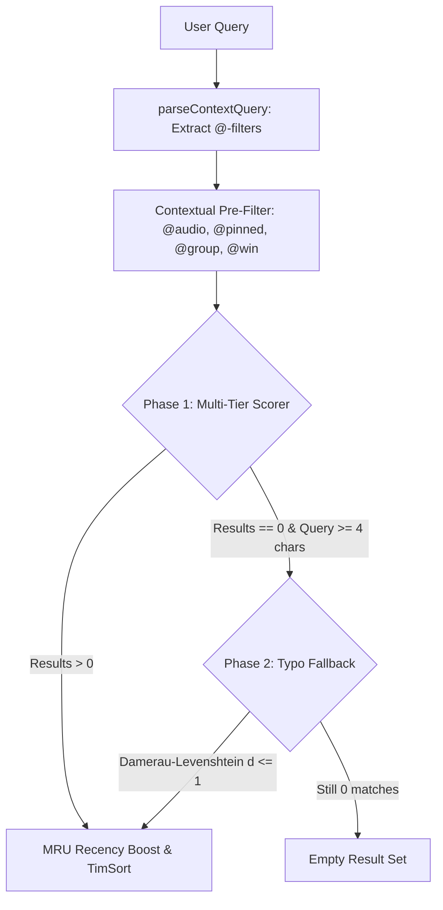

# Architecture: Search & Ranking Algorithm

InfoBoard features a specialized, deterministic lexical scoring engine implemented in [extension/src/search/scorer.ts](file:///home/ryantran/Projects/InfoBoard/extension/src/search/scorer.ts). It provides instant (< 0.2ms), predictable search results with zero runtime dependencies.

---

## 1. Multi-Tier Scoring Hierarchy & Two-Phase Pipeline

Search operates as a two-phase pipeline with contextual pre-filtering:



### Phase 1: High-Speed Lexical Scoring

Every candidate open tab is evaluated against the query. The algorithm assigns a base score from the highest tier matched:

```text
Score Hierarchy:
  Tier 1: Exact Domain or Title Prefix Match (950 - 1000 pts)
    └─ Example: query "ti" matches "tiki.vn" or "tiktok.com"
  Tier 2: Word-Boundary Prefix Match (800 - 850 pts)
    └─ Example: query "th" matches "Instagram - Threads" (score 800)
    └─ Example: query "go" matches "Google Search" at word boundary (score 850)
  Tier 3: Acronym Match (650 pts)
    └─ Example: query "gh" matches "GitHub"
    └─ Example: query "yt" matches "YouTube"
  Tier 4: Fuzzy Subsequence Matching with Clustering (200 - 600 pts)
    └─ fzf/VS Code style matching:
       - Base score: 480 pts
       - Consecutive character bonus: +15 pts per consecutive match
       - Word boundary / delimiter / CamelCase bonus: +40 pts
       - Span penalty: -4 pts per excess character span
       - Example: query "gdoc" matches "Google Docs"
       - Example: query "ytm" matches "YouTube Music"
       - Example: query "amz" matches "Amazon.com"
```

### Phase 2: Typo-Tolerance Fallback (Damerau-Levenshtein)

To maintain absolute minimum latency (< 0.05ms) during normal typing, typo tolerance is strictly evaluated in Phase 2:
- **Trigger Condition**: Phase 1 returned exactly `0` results, AND `cleanQuery.length >= 4`.
- **Algorithm**: Damerau-Levenshtein distance ($d \le 1$) using 3 rolling Int32 row buffers ($O(M)$ memory) with early-exit thresholding.
- **Transposition Handling**: Handles adjacent swaps (`githbu` $\rightarrow$ `github`, `youtbe` $\rightarrow$ `youtube`) as a single edit ($d = 1$).
- **Base Score**: 120 - 150 pts (retains MRU boost).

---

## 2. Contextual Quick Filters (`@-Syntax`)

InfoBoard parses query tokens prefixed with `@` into instantaneous structural filters before lexical matching:

| Filter Syntax | Alias | Description |
| :--- | :--- | :--- |
| `@audio` | `@a` | Show only tabs currently playing audio (`audible: true`) |
| `@pinned` | `@p` | Show only pinned tabs (`pinned: true`) |
| `@group` | `@g` | Show only tabs assigned to a Chrome tab group (`groupId > 0`) |
| `@win` | `@w` | Show only tabs residing in the current active window |

**Chained Queries**: Filters seamlessly combine with keywords, e.g.:
- `@audio lofi` $\rightarrow$ Finds tabs playing audio containing "lofi"
- `@pinned git` $\rightarrow$ Finds pinned GitHub / GitLab tabs
- `@audio` (alone) $\rightarrow$ Lists all audio tabs ordered by MRU recency

---

## 3. Most Recently Used (MRU) Recency Boost

When multiple tabs match a query at the same tier, InfoBoard breaks ties using an in-memory recency boost:

$$\text{Final Score} = \text{Base Tier Score} + \frac{50}{\text{mruRank} + 1}$$

- `mruRank = 0` (most recently active tab): receives $+50.0$ bonus points.
- `mruRank = 1` (previous tab): receives $+25.0$ bonus points.
- `mruRank = 2`: receives $+16.7$ bonus points.

### Strategic Rule: Dominance of Higher Tiers
A higher matching tier **always** dominates a lower tier, regardless of recency:
- An exact prefix match on an older tab (1000 pts) will rank above a subsequence match on the active tab ($480 + 50 = 530$ pts).

---

## 4. Empty Query & Quick Switch (Alt+Tab Pattern)

When the query is empty (`query === ''`):
1. All open tabs are returned sorted strictly by `mruRank` ascending (most recently used first).
2. The popup automatically highlights **index 1** (the previously active tab).
3. **Usage Pattern**: Press `Alt + W` $\rightarrow$ `Enter` to instantly toggle between your two most recent tabs, matching the OS `Alt + Tab` workflow across browser windows.

---

## 5. Normalization & Safety Guarantees

- **Whitespace & Case Insensitivity**: Queries and tab titles are trimmed and evaluated in lowercase.
- **Regex Safety**: InfoBoard escapes special characters or uses linear indexing instead of unescaped regular expressions, preventing ReDoS.
- **Domain Extraction**: Hostnames are cleanly extracted via `new URL(tab.url).hostname.replace(/^www\./i, '')` with fallback for invalid or internal schemes.
