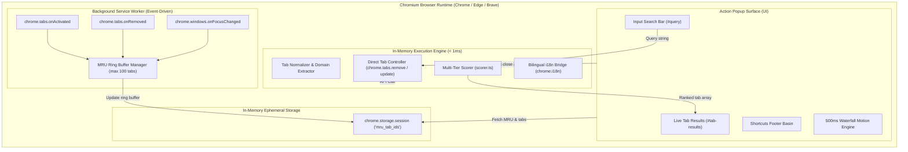
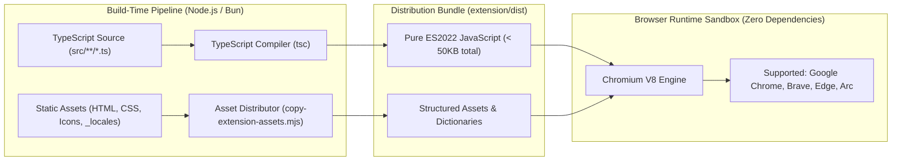

# Architecture: System Overview

InfoBoard is engineered as a **Pure Manifest V3 Chrome Extension**. It operates 100% inside Chromium's V8 engine and browser runtime sandbox, requiring no external companion native applications, no background daemons, no SQLite persistence, and no cloud connections.

---

## 1. System Topology

---

## 2. Component Ownership & Boundaries

### A. Focused Search Surface (`extension/src/search/`)
- **`surface-shell.html` & `surface-shell.css`**:
  - Encapsulates the 480x480px popup viewport with responsive dark/light theme variables.
  - Houses the custom 6px rounded scrollbar and vector SVG icons.
  - Implements the 500ms bidirectional waterfall animations (entrance cascade and reverse exit).
- **`surface-entrypoint.ts`**:
  - Initializes search input autofocus, ARIA accessibility attributes (`role="listbox"`, `role="option"`).
  - Handles keyboard shortcuts: arrow navigation (`↑`/`↓`), quick Enter selection, direct close (`Alt + D` / `Delete`), and dismiss (`Esc`).
  - Pre-selects the previous tab (index 1) on empty query for an instant `Alt+Tab` quick-switch flow.

### B. In-Memory Scorer & Tab Indexer (`extension/src/search/scorer.ts`)
- Evaluates queries against live tab snapshots entirely in RAM.
- Completes scoring and deterministic ranking of hundreds of tabs in less than **1 millisecond**.

### C. Background MRU Ring Buffer (`extension/src/background/`)
- **`service-worker.ts`**:
  - Event-driven service worker that sleeps when idle.
  - Wakes up on `tabs.onActivated`, `tabs.onRemoved`, and `windows.onFocusChanged` to update MRU recency in `chrome.storage.session`.
- **`mru-manager.ts`**:
  - Maintains a bounded ring buffer (capped at `MAX_MRU_SIZE = 100`) preventing memory bloat.

---

## 3. Ephemeral Execution Model

Manifest V3 terminates service workers after ~30 seconds of inactivity. InfoBoard is architected specifically to handle this:
1. **Zero Cold-Start Latency**: Popup loads tabs directly via `chrome.tabs.query({})` and reads `chrome.storage.session` in parallel (`Promise.all`), requiring no message exchange with a sleeping service worker.
2. **Session Storage Persistence**: `chrome.storage.session` lives in RAM across service worker sleep/wake cycles and automatically clears when the browser shuts down.

---

## 4. Build-Time vs. Runtime Boundary

A core architectural guarantee of InfoBoard is the strict isolation between the **development toolchain (build-time)** and the **client execution sandbox (runtime)**:

### Architectural Guarantees:
- **Zero Client Dependencies**: End-users installing InfoBoard run solely within Chromium's sandboxed V8 engine. No background daemons, local web servers, Python, or Node.js processes exist on the client machine.
- **Development Toolchain Role**: Node.js (or Bun) serves exclusively as an offline build harness—executing `tsc` type-checking, running the 34-test in-memory validation suite via `node --test`, and assembling production distribution ZIPs.
