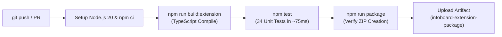

# Operations: CI/CD Pipeline

InfoBoard utilizes **GitHub Actions** for automated continuous integration, ensuring that every commit and Pull Request on `main` and `dev` adheres to strict quality, performance, and size gates.

---

## 1. CI Workflow Specification

The pipeline is defined in [.github/workflows/ci.yml](file:///home/ryantran/Projects/InfoBoard/.github/workflows/ci.yml).

---

## 2. Automated Quality Gates

Every CI run executes 4 essential validation gates:

### Gate 1: Type Checking & Compilation
- Runs `npm run clean && tsc -p extension/tsconfig.json`.
- Fails immediately on any TypeScript compilation or typing error.

### Gate 2: Full Test Suite Execution
- Runs `node --test tests/*.test.mjs`.
- Tests all 5 critical domains:
  - `manifest-and-bundle.test.mjs`: MV3 compliance, permission isolation, bundle size < 50KB.
  - `mru-manager.test.mjs`: MRU ring buffer, touch/remove operations, session hydration.
  - `scorer.test.mjs`: Prefix, boundary, acronym, and recency ranking.
  - `surface.test.mjs`: DOM listbox rendering, selection cycling, tab closing.
  - `types.test.mjs`: Normalization, domain extraction, audio/muted detection.

### Gate 3: Bundle Size Budget Enforcement
- The test suite asserts that the total uncompressed size of all distribution artifacts in `extension/dist` remains **strictly under 50 KB**.
- If any bloated dependency or unneeded code is introduced, CI fails immediately.

### Gate 4: Packaging Verification & Artifact Upload
- Runs `npm run package` to ensure the release packager produces a valid archive.
- Uploads the resulting `release/infoboard-v*.zip` as a downloadable GitHub Actions artifact for manual inspection.
