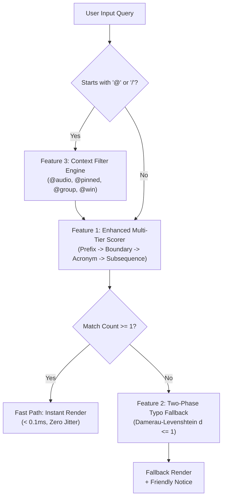

# RFC: Advanced Search Engine Enhancements

* **Status**: `Draft / Under Review`
* **Author**: InfoBoard Core Contributors
* **Created**: November 26, 2026
* **Target Milestone**: v0.2.0

---

## 1. Summary & Motivation

InfoBoard currently utilizes a deterministic multi-tier lexical matcher (Exact Prefix $\rightarrow$ Word Boundary $\rightarrow$ Acronym $\rightarrow$ Substring $\rightarrow$ MRU Boost). While this engine achieves sub-millisecond execution (< 0.1ms), real-world tab switching patterns expose three key user experience gaps:

1. **Inflexible Keyword Gaps**: Queries like `gdoc` (*Google Docs*), `ytm` (*YouTube Music*), or `amz` (*Amazon*) return zero results because characters are non-contiguous and do not match strict acronym boundaries.
2. **Fast-Typing Typos**: Power users typing at high speed frequently invert adjacent keys (`githbu`) or miss a character (`youtbe`), producing frustrating zero-result screens.
3. **Context-Heavy, Title-Light Queries**: When 50–100 tabs are open, users often search by *state* rather than exact names (*"Where is the tab playing loud audio?"*, *"Show me my pinned working tabs"*).

This proposal outlines three targeted algorithmic enhancements to resolve these gaps while preserving InfoBoard's foundational contract: **Pure Manifest V3**, **zero external runtime dependencies**, **uncompressed bundle < 50 KB**, and **sub-millisecond (< 1ms) execution**.

---

## 2. Comparative Analysis: Why Traditional Full-Text Search Engines Are Unsuitable

Before adopting custom algorithms, we evaluated traditional full-text search paradigms (e.g., Mini Inverted Index, Trie Autocomplete, BM25/TF-IDF, Min-Heap):

```text
┌────────────────────────────────────────────────────────────────────────┐
│ Comparison: Full-Text Engine vs. Ephemeral Tab Switcher                │
├────────────────────────┬─────────────────────┬─────────────────────────┤
│ Architectural Factor   │ Inverted Index/BM25 │ InfoBoard Tab Switcher  │
├────────────────────────┼─────────────────────┼─────────────────────────┤
│ Dataset Scale (N)      │ 10,000 - 1,000,000  │ 20 - 150 tabs (max 300) │
│ Document Length        │ 1,000 - 50,000 words│ Title: ~50 chars        │
│ Lifecycle              │ Static/Periodic sync│ Ephemeral (changes/sec) │
│ User Intent            │ Content Discovery   │ Rapid Tab Switching     │
│ V8 Overhead            │ High memory & map GC│ 0.02ms linear scan      │
└────────────────────────┴─────────────────────┴─────────────────────────┘
```

### Technical Trade-Off Justifications:
- **Inverted Index & Postings Lists**: Building an inverted index on every popup open requires tokenizing 50–100 tabs and allocating Maps/Arrays in V8 memory. In practice, a direct linear scan of 50 tab objects in Chromium's V8 takes ~0.05ms, making index construction slower and heavier than linear evaluation.
- **Trie (Prefix Tree) for Autocomplete**: Tries are optimized for suggesting completion terms (e.g., search box auto-suggest). Tab switchers require immediate item activation, not keyword expansion.
- **BM25 / TF-IDF**: Term frequency and inverse document frequency are designed for multi-page corpora. They fail to understand tab switching semantics where **recency (MRU)** and **acronyms** matter far more than document word counts.
- **Min-Heap for Top-K**: Min-Heaps reduce sorting complexity to $O(N \log K)$ on large datasets ($N \ge 50,000$). For $N \approx 50$, native V8 C++ `Array.prototype.sort()` (TimSort) finishes in ~0.01ms, far outperforming JavaScript-implemented heap manipulation.

---

## 3. Proposed Core Enhancements



---

### Feature 1: Fuzzy Subsequence Matching (fzf / VS Code Style)

#### Problem
Users recall distinct syllables or abbreviations rather than continuous substrings. For example:
- `gdoc` $\rightarrow$ **G**oogle **Doc**s
- `ytm` $\rightarrow$ **Y**ou**T**ube **M**usic
- `amz` $\rightarrow$ **Am**a**z**on

#### Algorithm
Evaluate whether query characters appear in the tab title or domain in strictly sequential order, rewarding character clustering and word boundaries:

$$\text{SubsequenceScore} = \text{Base (500)} + \text{ConsecutiveBonus} + \text{BoundaryBonus} - \text{SpanPenalty}$$

- **Consecutive Bonus**: $+25$ points for each adjacent matched character pair.
- **Boundary Bonus**: $+40$ points if a character matches a word boundary (following space, slash, dash) or CamelCase uppercase letter.
- **Span Penalty**: Deduct points proportional to the total distance between the first and last matched character in the target string.

#### Scoring Hierarchy Position
```text
Tier 1: Exact Prefix on Title / Domain (1000 pts)
Tier 2: Word-Boundary Prefix Match (800 - 850 pts)
Tier 3: Acronym Match (650 pts)
Tier 4: Subsequence Match [NEW] (500 - 580 pts)
Tier 5: General Substring Match (400 - 450 pts)
Tier 6: MRU Recency Boost (+ 50 / (rank + 1))
```

---

### Feature 2: Two-Phase Typo Tolerance Fallback

#### Problem
Fuzzy matching all tabs on every keystroke introduces unwanted false positives and degrades performance. However, power users frequently make single-character slips:
- Transposition: `githbu` $\rightarrow$ `github`
- Substitution: `yoytube` $\rightarrow$ `youtube`
- Omission: `youtbe` $\rightarrow$ `youtube`

#### Two-Phase Execution Design
1. **Phase 1: Fast Path (99% of queries)**:
   - Run tiers 1–5.
   - If results count $\ge 1$, terminate immediately and render results in < 0.1ms.
2. **Phase 2: Typo Fallback Path (1% of queries)**:
   - Triggered **only** when Phase 1 returns 0 results and `query.length >= 4`.
   - Evaluates a lightweight Damerau-Levenshtein distance calculation bounded at **distance $\le 1$**.
   - Displays closest matches with a subtle indicator: *"No exact match for 'githbu'. Showing results for 'github'"*.

#### Performance Guarantee
Because Phase 2 only runs on zero-match outcomes, standard typing performance is never penalized.

---

### Feature 3: Contextual Quick Filters (`@-Syntax`)

#### Problem
Users with high tab counts (50+) frequently look for tabs by functional state rather than names.

#### Filter Syntax Specification
When query tokens start with `@` (or `/`), InfoBoard applies functional state filters before lexical scoring:

| Syntax | Short Form | Target Scope |
| :--- | :---: | :--- |
| `@audio` | `@a` | Only tabs where `tab.audible === true` |
| `@pinned` | `@p` | Only tabs where `tab.pinned === true` |
| `@group` | `@g` | Only tabs belonging to a Chrome Tab Group (`tab.groupId > 0`) |
| `@win` | `@w` | Only tabs inside the current browser window (`tab.windowId === currentWindowId`) |

#### Chained Filtering
Users can combine filters with search terms seamlessly:
- `@audio lofi` $\rightarrow$ Filters to audible tabs, then searches for "lofi".
- `@p git` $\rightarrow$ Filters to pinned tabs, then searches for "git".

---

## 4. Architectural & Performance Budget

| Metric | Current Baseline (v0.1.0) | Target with Enhancements | Status / Margin |
| :--- | :---: | :---: | :---: |
| **Compiled JS Size** | ~22 KB | **~25 KB** | Safe (< 50 KB ceiling) |
| **Release Zip Size** | ~61 KB | **~64 KB** | Safe (< 100 KB ceiling) |
| **External Dependencies** | 0 | **0** | Strict Pure MV3 |
| **Average Query Latency** | < 0.10 ms | **< 0.20 ms** | 100% In-Memory RAM |
| **Unit Test Coverage** | 34 tests | **45+ tests** | Automated CI verified |

---

## 5. Implementation Roadmap

1. **Milestone 1**: Implement `matchSubsequence` in `scorer.ts` with comprehensive unit tests (`tests/scorer.test.mjs`).
2. **Milestone 2**: Implement Context Filters (`@audio`, `@pinned`, `@group`, `@win`) in `surface-entrypoint.ts` and query parser.
3. **Milestone 3**: Implement Two-Phase Typo Fallback (`damerauLevenshteinDistance <= 1`) on zero-result fallback.
4. **Milestone 4**: Update User Guide and Keyboard Shortcuts documentation.
