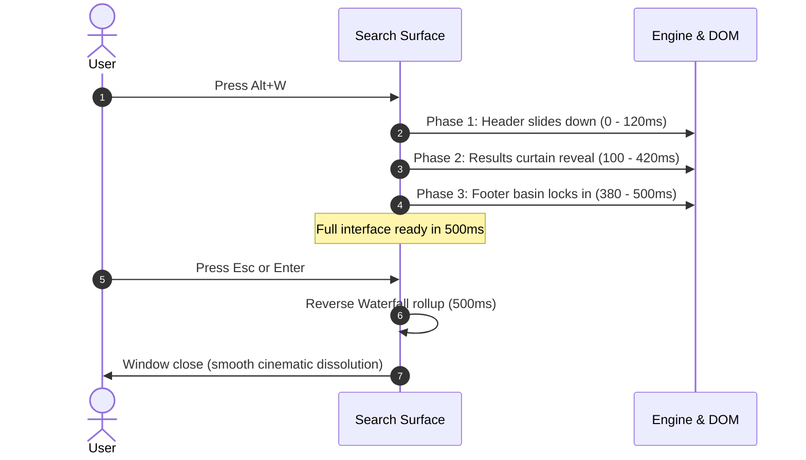

# User Guide: Features & Visual Design

InfoBoard is crafted with modern design sensibilities, subtle cinematic micro-interactions, and accessibility support.

---

## 1. Visual Elements & Indicators

```text
┌────────────────────────────────────────────────────────┐
│  🔍 Search open tabs by title or domain...             │
├────────────────────────────────────────────────────────┤
│  ▶ 🌐 GitHub - ryantr-statinops/InfoBoard              │
│       github.com • Current • Pinned                [x] │
│                                                        │
│    🎵 Spotify - Chill Lofi Mix                         │
│       open.spotify.com • Audio                     [x] │
│                                                        │
│    🔇 YouTube - Video Player                           │
│       youtube.com • Muted                          [x] │
├────────────────────────────────────────────────────────┤
│  [↑][↓] Navigate  [↵] Switch  [Alt+D] Close tab  [esc] │
└────────────────────────────────────────────────────────┘
```

### Tab Badges
- **`Current`**: Indicates the currently active tab in the focused window.
- **`Pinned`**: Indicates a tab that has been pinned to your tab strip.
- **`Audio`**: Highlighted badge with animated soundwave indicator when audio is playing.
- **`Muted`**: Subtle badge with muted speaker icon when audio playback is silenced.

### Close Tab Button (`[x]`)
- Appears on the right side of tab items on mouse hover or when navigated via keyboard.
- Features smooth opacity transition with subtle red highlight on hover.
- Click action stops event propagation and closes the tab directly without switching.

---

## 2. Motion Engine: Bidirectional 500ms Waterfall

InfoBoard features a synchronized motion lifecycle designed to feel fluid and natural:



### Accessibility & Reduced Motion
- When system accessibility setting **Prefers Reduced Motion** is enabled, all slide transitions and clip-path keyframes are disabled (`animation: none !important`), rendering UI elements immediately without motion.

---

## 3. Theme & Scrollbar
- **Adaptive Dark / Light Theme**: Uses CSS custom variables (`--bg-primary`, `--bg-secondary`, `--border-color`, `--text-primary`) automatically aligning with browser dark/light mode.
- **Theme-Aware Scrollbar**: Features a 6px rounded pill scrollbar matching Chromium's native styling without jarring desktop scrollbars.
